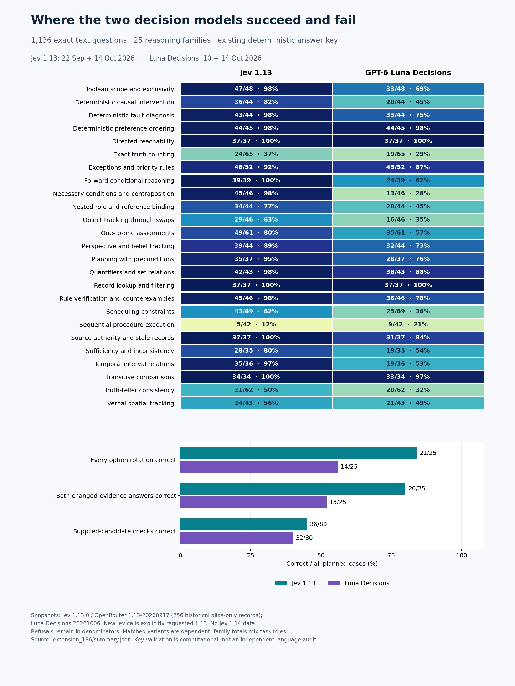

# Jev 1.13 vs Luna Decisions: 136-question diagnostic extension

14 October 2026. This extends the original 1,000-question comparison to a frozen **1,136-question reference**. It adds complete matched tests rather than another random sample. The original 1,000 responses and their published scores remain unchanged. No Jev 1.14 results enter this reference.

## New results

| Additional questions | Jev 1.13 | Luna Decisions |
|---|---:|---:|
| Attempted | 136 | 136 |
| Valid choices | 136 | 130 |
| Correct against the existing key | 93/136 (68.4%) | 75/136 (55.1%) |
| Wrong valid choices | 43 | 55 |
| Unanswered | 0 | 6 |
| Probability-format warnings | 3 | 0 |

The extension is deliberately diagnostic, includes dependent questions and different task proportions, and must not be interpreted as an independent representative sample. In particular, its lower accuracy is not evidence of regression from the original scores.

## What changes in the interpretation

The added questions reinforce the original distinction: Jev 1.13 is strong at applying stated rules to a supplied situation, while repeated state changes and exact counting remain weak. In the full reference, Jev answers all 37 lookup and all 37 directed-reachability questions correctly, but only 5/42 sequential-procedure questions. Luna also answers all lookup and reachability questions correctly, while scoring 9/42 on sequential procedures. These are observations on these generated questions, not guarantees for new tasks.

The supplied-candidate checks make the weakness more specific. Jev gets 36/80 and Luna 32/80, even though the proposed arrangement or hypothetical location is supplied. Searching for a solution therefore cannot be the only difficulty: errors remain in checking constraints or counting their consequences. The small panel does not establish an internal mechanism.

The rotation panels also qualify an earlier claim. Balanced overall option counts do not establish zero position sensitivity. Jev changes semantic choice in 3/25 fully answered panels; Luna changes in 6/21. Jev is more consistent here, but neither is invariant across all observed panels. On the 21 panels both fully answer, Jev gets every rotation correct in 18, compared with Luna's 14.

Jev handles changed evidence more reliably in this selection: both answers are correct in 20/25 planned pairs, compared with Luna's 13/25. On the 22 pairs both answer, the comparison is 18/22 versus 13/22. This tests appropriate response to one edited fact, not general real-world adaptability.

High confidence still selects a much stronger subset. Jev's confidence ≥0.95 group contains 543 correct decisions out of 544, covering 47.9% of the full reference. Luna's corresponding group contains 96/96, covering 8.5%. Luna's smaller error-free sample does not demonstrate a zero error rate; Jev's larger coverage does not eliminate its observed error. These thresholds were inspected on the evaluation results and need separate validation before operational use.

## What the complete matched tests reveal

These panels combine retained historical responses with the new responses. They are diagnostic first-response comparisons across dates and, for historical Jev, across provider routes. They are not fresh same-session repeats.

| Planned panel / outcome | Jev 1.13 | Luna Decisions |
|---|---:|---:|
| Five-position panels: all five answered / 25 | 25 | 21 |
| Five-position panels: all five correct / 25 | 21 | 14 |
| Same semantic choice across all five / complete panels | 22/25 | 15/21 |
| Changed-evidence pairs: both answered / 25 | 25 | 22 |
| Changed-evidence pairs: both correct / 25 | 20 | 13 |
| Candidate checks correct / 80 | 36 | 32 |
| Original parent puzzles correct / 16 | 9 | 6 |
| Parent plus all five candidate checks correct / 16 | 1 | 0 |

Semantic consistency aligns option meanings, not their displayed numbers. Consistent wrong answers are not successful solutions. Changing a choice after an evidence edit is also insufficient: getting both members correct is the stronger criterion. Refusals count as unanswered, not as demonstrated logical errors. The machine-readable summary also reports results restricted to panels fully answered by both models.

### Supplied-candidate verification by task family

Each family has four parent puzzles and 20 candidate checks. Supplying a proposed arrangement reduces search, but checking or counting its constraints can still be difficult.

| Family | Jev parent / 4 | Jev checks / 20 | Luna parent / 4 | Luna checks / 20 |
|---|---:|---:|---:|---:|
| Scheduling constraints | 3 | 9 | 1 | 7 |
| One-to-one assignments | 3 | 14 | 2 | 9 |
| Exact truth counting | 1 | 8 | 1 | 10 |
| Truth-teller consistency | 2 | 5 | 2 | 6 |

## Frozen reference for future releases

| Existing-key score, descriptive only | Jev 1.13 | Luna Decisions |
|---|---:|---:|
| Original 1,000 questions | 817/1,000 (81.7%) | 612/1,000 (61.2%) |
| All 1,136 questions | 910/1,136 (80.1%) | 687/1,136 (60.5%) |
| Unanswered across 1,136 | 0 | 23 |

The combined number mixes core questions and dependent diagnostic variants; it is a reproducible reference statistic, not a stronger estimate of general ability. Use matched per-family and per-panel outcomes to assess subsequent releases. The full original question text, instructions and option order are frozen in `questions_1136.csv`; `reference_manifest.json` binds the input and response hashes.

### All 1,136 questions by reasoning family

These per-family totals also contain dependent variants. The JSON summary additionally separates roles and difficulty levels.

| Family | n | Jev correct | Luna correct | Luna unanswered |
|---|---:|---:|---:|---:|
| Boolean scope and exclusivity | 48 | 47 (97.9%) | 33 (68.8%) | 0 |
| Deterministic causal intervention | 44 | 36 (81.8%) | 20 (45.5%) | 0 |
| Deterministic fault diagnosis | 44 | 43 (97.7%) | 33 (75.0%) | 1 |
| Deterministic preference ordering | 45 | 44 (97.8%) | 44 (97.8%) | 0 |
| Directed reachability | 37 | 37 (100.0%) | 37 (100.0%) | 0 |
| Exact truth counting | 65 | 24 (36.9%) | 19 (29.2%) | 0 |
| Exceptions and priority rules | 52 | 48 (92.3%) | 45 (86.5%) | 0 |
| Forward conditional reasoning | 39 | 39 (100.0%) | 24 (61.5%) | 5 |
| Necessary conditions and contraposition | 46 | 45 (97.8%) | 13 (28.3%) | 0 |
| Nested role and reference binding | 44 | 34 (77.3%) | 20 (45.5%) | 0 |
| Object tracking through swaps | 46 | 29 (63.0%) | 16 (34.8%) | 1 |
| One-to-one assignments | 61 | 49 (80.3%) | 35 (57.4%) | 8 |
| Perspective and belief tracking | 44 | 39 (88.6%) | 32 (72.7%) | 1 |
| Planning with preconditions | 37 | 35 (94.6%) | 28 (75.7%) | 0 |
| Quantifiers and set relations | 43 | 42 (97.7%) | 38 (88.4%) | 0 |
| Record lookup and filtering | 37 | 37 (100.0%) | 37 (100.0%) | 0 |
| Rule verification and counterexamples | 46 | 45 (97.8%) | 36 (78.3%) | 1 |
| Scheduling constraints | 69 | 43 (62.3%) | 25 (36.2%) | 3 |
| Sequential procedure execution | 42 | 5 (11.9%) | 9 (21.4%) | 0 |
| Source authority and stale records | 37 | 37 (100.0%) | 31 (83.8%) | 0 |
| Sufficiency and inconsistency | 35 | 28 (80.0%) | 19 (54.3%) | 0 |
| Temporal interval relations | 36 | 35 (97.2%) | 19 (52.8%) | 0 |
| Transitive comparisons | 34 | 34 (100.0%) | 33 (97.1%) | 0 |
| Truth-teller consistency | 62 | 31 (50.0%) | 20 (32.3%) | 1 |
| Verbal spatial tracking | 43 | 24 (55.8%) | 21 (48.8%) | 2 |

### Confidence-filtered reference outcomes

Exploratory cutoffs, not held-out production thresholds. Retained populations differ by model.

| Confidence | Jev retained | Jev correct | Luna retained | Luna correct |
|---|---:|---:|---:|---:|
| ≥0.8 | 696 | 682 (98.0%) | 223 | 220 (98.7%) |
| ≥0.9 | 611 | 607 (99.3%) | 142 | 142 (100.0%) |
| ≥0.95 | 544 | 543 (99.8%) | 96 | 96 (100.0%) |

## Selection and execution

Exactly 68 additions complete all 16 parent-plus-five-check sets; 57 more complete one five-position rotation panel per family; 11 more complete at least one changed-evidence pair per family. The deterministic selection used item metadata and historical coverage, never gold answers or model successes. Ties used ascending IDs. Rotation anchors cover levels 1/2/3/4 in counts 11/5/4/5; this cost-minimizing extension is not level-balanced. All semantic inputs are the unchanged bank texts, with no demonstrations, tools, answer feedback or model-specific tuning.

- **Jev**: requested `typesafe/jev-1.13`; all successful responses returned `typesafe/jev-1.13-20260917`. 136 HTTP attempts; 75,270 input / 7,072 output tokens; $0.00316134 reported cost. Valid-choice response-body median 154 ms; p95 245 ms.
- **Luna**: requested `openai/gpt-6-luna-decisions`; all successful responses returned `openai/gpt-6-luna-decisions-20261006`. 142 HTTP attempts; 43,919 input / 0 output tokens; $0.00439190 reported cost. Valid-choice response-body median 237 ms; p95 714 ms.

The runner retains one first response per item; retries only bounded transport/HTTP failures, at most twice. Luna's six new unanswered items each returned HTTP 502 refusals on both attempts. Those 12 attempts report no usage/cost, so their billed cost is unknown. All Jev requests explicitly used `typesafe/jev-1.13`, never `jev-latest`. Both model IDs are guarded against returned-version drift. Historical `jev-latest` responses are retained as the owner's September 22 Jev 1.13 run; 256 of their original response records contain only that alias.

### Probability parsing disclosure

Three new Jev responses supply a valid choice and confidence but probabilities summing to 0.99. The strict runner recorded them as `invalid_response` and left its parsed choice blank. Raw records remain unchanged. The separate `decisions_jev_1136.csv` extracts those first typed choices, flags the distribution warning, and scores the choices against the existing key. This follows the original protocol's separation of choice accuracy from probability quality. No probabilities are renormalized, and none of these items was resampled. The same check flags ten pre-existing historical Jev distributions; their originally recorded choices and scores are unchanged.

## Separate 256-question Jev 1.13 repeatability recheck

A supplementary recheck replayed the historical gateway's 256 alias-only items through the pinned OpenRouter Jev 1.13 route. All 256 returned `typesafe/jev-1.13-20260917`. Choices agreed on 248/256 (96.9%); eight changed. Accuracy changed from 213/256 (83.2%) to 211/256 (82.4%): two wrong-to-correct, four correct-to-wrong, and two wrong-to-different-wrong changes. This crosses dates and routes; it cannot identify whether the differences arose from provider processing, inference variation, caching or other serving changes. It is not evidence of Jev 1.14. Its $0.00629882 reported cost is separate from the extension. One recheck probability distribution also summed to 0.99; the same choice-only scoring policy applies. The recheck does **not** replace any reference answer.

## Validation and limitations

Question hashes, native packet identities, returned snapshots, first-response retention, attempt ledgers and aggregate arithmetic are checked. All scores use the original external answer key; its fingerprint matches the original comparison. The key has deterministic solver validation but has not received a fully independent audit of every printed English question. These results do not certify that key. There is no Jev 1.14 or multimodal evidence in this report. Confidence filtering is exploratory, not a verified deployment guarantee.

## Artifacts and reproduction

- [Selection and panel manifest](selection_manifest.json), [136 new questions](questions_136.csv), [all 1,136 questions](questions_1136.csv), [reference hashes](reference_manifest.json).
- [Jev raw results](results_jev.csv), [Luna raw results](results_luna.csv), and attempt ledgers (`attempts_jev.jsonl`, `attempts_luna.jsonl`).
- [Normalized Jev reference](decisions_jev_1136.csv), [normalized Luna reference](decisions_luna_1136.csv), [aggregate summary](summary.json), [checksums](checksums.json).
- [Separate 256-question recheck](recheck_256/results_completed.csv), [recheck attempts](recheck_256/attempts.jsonl), [recheck manifest](recheck_256/run_manifest.json).

The canonical reproduction scripts live in [luna-decisions-benchmark](https://github.com/etsabary/luna-decisions-benchmark). `python3 validate_extension.py` checks the public evidence without a key or network. `python3 analyze_extension.py --answer-key /path/to/answer_key_PRIVATE.csv --recheck-dir extension_136/recheck_256` reproduces gold-dependent aggregates. `python3 run_extension.py run --model jev` (or `luna`) is a dry-run; add `--execute --env-file /external/path/.env` only for a separately recorded paid replay. Published output files are retained on resume; a new paid replay requires a separate output destination, not deleting frozen responses.
